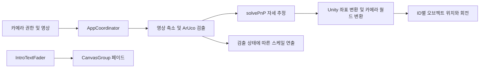

# 기술 구조

이 문서는 보존된 소스·씬·설정의 정적 검토 결과입니다. 실행 검증을 마친 아키텍처를 의미하지 않습니다.

## 처리 흐름

1. Coordinator가 카메라 권한과 WebCamTexture 준비를 기다립니다.
2. 카메라 내부 파라미터로 검출기를 초기화하고 마커 ID → GameObject 사전을 만듭니다.
3. Update에서 카메라 자세를 갱신하고 영상을 축소·변환해 마커를 검출합니다.
4. 마커 코너와 실제 마커 길이를 사용해 solvePnP로 자세를 계산합니다.
5. 위치·회전을 보간하고 카메라의 월드 행렬과 결합해 오브젝트 Transform에 적용합니다.
6. ID별 검출 상태에 따라 스케일을 복원하거나 줄입니다. 검출 0개일 때 이 단계가 건너뛰어질 수 있습니다.

## 보존 개발본의 설정

| 항목 | 확인값 |
|---|---|
| Unity | 6000.2.4f1 |
| Meta MR Utility Kit / XR Core | 72.0.0 / 72.0.0 |
| Oculus XR Plugin / XR Management | 4.5.2 / 4.5.1 |
| Android | ARM64, IL2CPP, 최소 API 32 |
| Manifest 대상 | Quest 3 / Quest 3S |
| 카메라 권한 | horizonos.permission.HEADSET_CAMERA |
| 마커 | DICT_4X4_50, 한 변 0.1m, ID 0/1 |
| 영상 축소 / 자세 보간 | 2배 / 계수 0.5 |
| 소실 지연 / 퇴장 | 0.05초 / 0.15초 |
| 재등장 | 0.05 설정의 프레임별 Lerp; 고정 시간 완료 방식 아님 |
| 인트로 | 대기 0.5초 → 등장 1초 → 유지 3초 → 퇴장 1초 |

이는 보존된 설정값이며 최신 권장 조합이나 정상 동작 확인 결과는 아닙니다. 씬 자체는 공개 준비본에 포함하지 않았으므로 Inspector 연결은 코드만으로 복원되지 않습니다.

## 표시와 추적의 구분

코드 초기 상태는 카메라 디버그 뷰이며 A 버튼으로 표시 모드를 전환합니다. 모드 전환 시 마커 오브젝트의 Renderer 표시도 바뀝니다. 보이지 않는 현상이 검출 실패인지 표시 설정인지 구분해야 합니다.

검출이 끊긴 동안 현실 물건이 이동한 위치를 계속 알아내는 구조는 아닙니다. 영구 공간 앵커나 가림 뒤의 물건 추적을 구현했다고 표현하지 않습니다.
